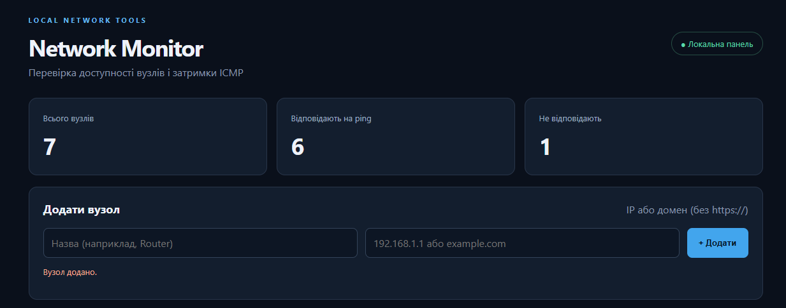
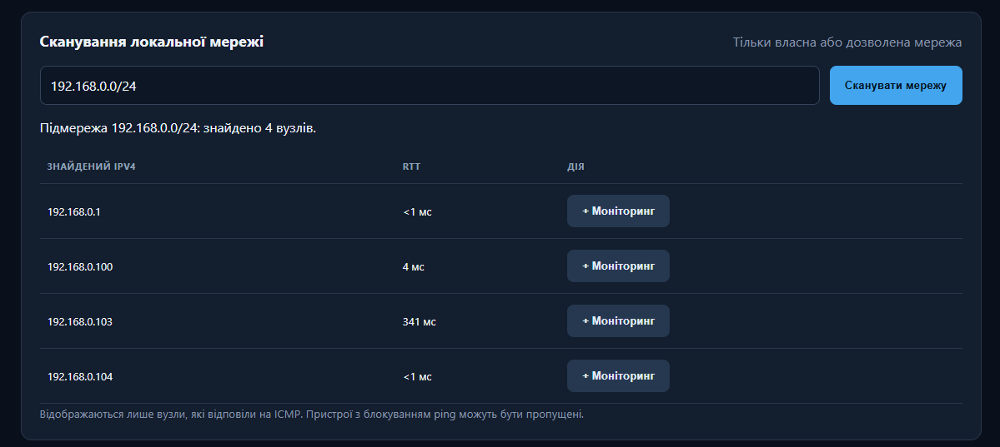
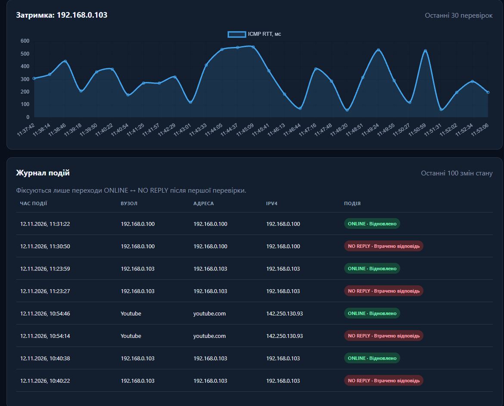

# Network Monitor

Навчальний прикладний інженерний проєкт на Python для моніторингу доступності мережевих пристроїв і сайтів. Вебпанель показує IPv4-адреси, стан ICMP, час відповіді (RTT), статистику та історію змін стану.

**Автор:** Григор’єв Георгій Артемович, група М-КІ-52.

## Можливості

- Додавання та видалення до 30 вузлів за IPv4-адресою або доменом.
- DNS-розпізнавання доменів та відображення отриманої IPv4-адреси.
- Перевірка доступності ICMP ping вручну та у фоновому режимі (інтервал 30 с за замовчуванням після завершення циклу).
- Вимірювання RTT з відповіді ping, зокрема значень менше 1 мс.
- Сканування дозволеної приватної IPv4-підмережі /24–/32 (до 256 адрес), додавання знайдених вузлів.
- Статистика успішних перевірок та графік останніх 30 результатів.
- Журнал останніх 100 переходів ONLINE → NO REPLY та NO REPLY → ONLINE.
- Збереження даних у SQLite.

## Технології

Python 3.11+, Flask, SQLite, HTML, CSS, JavaScript, Chart.js, стандартні модулі `socket`, `subprocess`, `ipaddress`, `threading` та `concurrent.futures`.

## Структура

```text
network-monitor/
├── app.py              # Flask API, БД, фоновий моніторинг
├── network.py          # DNS, ping, сканування підмережі
├── requirements.txt   # залежності
├── templates/
│   └── index.html      # вебпанель
├── static/
│   ├── app.js          # запити API, графік і журнал
│   └── style.css       # оформлення
├── tests/
│   └── test_app.py     # перевірки логіки
├── screenshots/       # демонстраційні знімки
└── README.md
```

`monitor.db` створюється автоматично під час запуску; не потрібно публікувати її в GitHub.

## Запуск у Windows

Установіть Python 3.11+ та відкрийте термінал у папці проєкту:

```powershell
py -m venv .venv
.venv\Scripts\python.exe -m pip install -r requirements.txt
.venv\Scripts\python.exe app.py
```

Відкрийте <http://127.0.0.1:5000/>. Для зупинки сервера натисніть `Ctrl+C`.

У Linux/macOS: `python3 -m venv .venv`, `source .venv/bin/activate`, `pip install -r requirements.txt`, `python app.py`.

## Алгоритм роботи

1. Користувач додає IP-адресу або домен через вебформу.
2. Flask приймає запит, перевіряє адресу та зберігає вузол у SQLite.
3. Python визначає IPv4 і виконує системну команду ping без shell; аналізує відповідь та RTT.
4. Результат записується в `checks`. Якщо стан змінився, у `events` створюється подія.
5. JavaScript завантажує дані через REST API та оновлює таблицю, статистику, графік і журнал.

## Демонстрація

**1. Панель моніторингу (початкова версія).** Додавання вузла та перевірка доступності.



**2. Сканування та DNS (v2).** Виявлення вузла й відображення IPv4 та RTT. На знімку введено одну адресу (/32); для всієї домашньої підмережі використовується, наприклад, `192.168.0.0/24` за відповідної маски.



**3. Моніторинг смартфона (v2).** Реальний локальний вузол `192.168.0.103`, статистика і графік ICMP RTT.



### Перевірка журналу (v3)

Під’єднайте смартфон до тієї самої Wi-Fi мережі, додайте його IPv4, перевірте стан ONLINE. Вимкніть Wi-Fi, повторіть перевірку; після відновлення Wi-Fi перевірте ще раз. За зміни стану у журналі мають з’явитися дві події. Знімок фінального журналу можна додати до `screenshots/events.png` після фактичного тестування.

## Обмеження

- NO REPLY означає відсутність ICMP-відповіді, а не гарантоване вимкнення пристрою.
- ICMP не підтверджує доступність вебсервісу HTTP і не виявляє всі пристрої.
- Старі вимірювання тривалості команди ping не відображаються як RTT.
- Скануйте лише власну або дозволену мережу; панель призначена для локального запуску.
- Chart.js завантажується через CDN, тому для графіка потрібне інтернет-з’єднання.

## Висновок

Проєкт демонструє практичне використання Python для мережевої діагностики, роботи з базою даних та створення вебінтерфейсу. Реалізовано моніторинг вузлів, сканування локальної мережі, історію RTT та журнал зміни станів.
